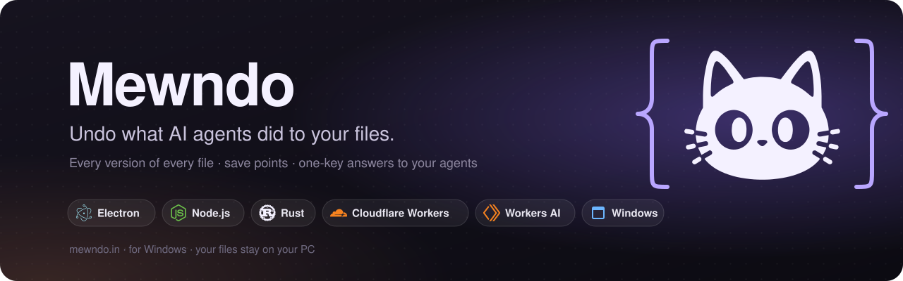

<p align="center">
  <a href="https://www.mewndo.in/"></a>
</p>

<p align="center">
  <a href="https://www.mewndo.in/get"><b>Download for Windows</b></a> ·
  <a href="https://www.mewndo.in/">Website</a> ·
  <a href="docs/features.md">Every feature</a> ·
  <a href="docs/what-mewndo-can-and-cant-undo.md">What it can't undo</a> ·
  <a href="docs/spec.md">Spec</a>
</p>

---

AI coding agents like Claude Code, Codex and Cursor work fast, and sometimes they delete the wrong folder,
overwrite a file you needed, or keep going when they should have asked. **Mewndo** sits beside them on your
Windows PC. It keeps every version of every file in the folders you protect, takes a save point before each risky
step, asks you before anything dangerous runs, and puts a whole folder or just a few files back the way they
were, in one click.

Real people trust it with their files, so correctness comes before features, and every feature below says what it
can't do.

## Contents

- [At a glance](#at-a-glance)
- [Features in detail](#features-in-detail)
  - [Protection and undo](#1-protection-and-undo)
  - [The dock and the Agent Desk](#2-the-dock-and-the-agent-desk)
  - [Talking to your agents](#3-talking-to-your-agents)
  - [Clef: the decision router](#4-clef-the-decision-router)
  - [Voice](#5-voice)
  - [Receipts and the Flight Recorder](#6-receipts-and-the-flight-recorder)
  - [Connecting your agents](#7-connecting-your-agents)
  - [Guarded computer use and Show Me skills](#8-guarded-computer-use-and-show-me-skills)
  - [Cloud accounts](#9-cloud-accounts)
- [Tech stack](#tech-stack)
- [How it fits together](#how-it-fits-together)
- [Privacy: what leaves your PC](#privacy-what-leaves-your-pc)
- [Installing and updates](#installing-and-updates)
- [How fast](#how-fast)
- [Development](#development)

## At a glance

**Works** means built, tested and used by the app. **Built** means built and tested, but not yet run on Windows
or against the real service. The full list, with every limit, is in [docs/features.md](docs/features.md).

| Feature | What it does | Status |
|---|---|---|
| Protected folders | Every version of every file, in several folders at once | Works |
| Save points and restore | Put a folder or chosen files back; undo the restore itself | Works |
| Guard and Brake | Ask before risky commands; freeze or stop an agent | Works |
| Agent Inbox | Answer your agents' questions from a card, with one key | Works |
| Talk box | Type or speak a message, and Mewndo picks the agent | Works |
| Clef router | Rules decide, with a cloud model for the hard cases | Works (rules), Built (model) |
| Cloud voice | Whisper on Workers AI, with Windows' recognizer as the fallback | Built |
| Gateway | Cloudflare Worker for Clef and voice, with no invite needed | Deployed |
| Receipts | Checks an agent's "I did X" against what it really did | Built |
| Flight Recorder | Signed, hash-chained log of every decision and restore | Works |
| Lanes | Terminal tabs for Claude Code, Codex and Cursor | Built |
| Guarded computer use | Agents can click and type, and every action asks you first | Built, off by default |
| Show Me skills | Record a task once; agents replay it under the same guard | Built, off by default |
| Gmail, Drive, Notion, GitHub | Undo changes in cloud accounts | Built, not connected |
| Windows installer | One per-user installer with everything in it | Works, unsigned |

## Features in detail

### 1. Protection and undo

The heart of Mewndo, carried over from v0 and tested hardest.

- **Protected folders.** Protect as many folders as you like, each with its own history. Mewndo's data lives in
  your app data folder, never inside a protected folder. If a folder goes missing, Mewndo tells you and offers
  **Locate…** or **Remove from Mewndo…**, and it never touches the folder itself.
- **Every version of every file.** Files are stored by their SHA-256, and text is compressed. Symbolic links and
  junctions are stored as links and never followed. Files over 50 MB are skipped, and Mewndo records that it
  skipped them. `node_modules`, `.venv`, `dist`, `build` and cache folders are ignored, while `.git` is kept.
- **Save points** are made:
  - by hand;
  - when an agent starts;
  - every 10 minutes while one runs and files have changed;
  - before every Claude Code command, once its hooks are connected;
  - before every restore.

  Changes made while Mewndo was closed are picked up the next time it starts.
- **Restore** a whole folder, only the files you choose, or a copy into a separate folder. Every file is written
  to a temporary file, checked against its SHA-256, and then renamed into place. Anything a restore replaces goes
  to Mewndo's trash, never deleted for good. A restore cut short by a crash finishes on the next start, and a
  restore can itself be undone.
- **Guard** asks Mewndo before an agent runs a shell command or edits a file. Your rules say allow, deny or ask.
- **Brake** freezes or stops an agent's whole process tree at once.
- **Local MCP server** (`mewndo-core mcp`): agents can make save points, ask to delete files and report progress.
  Undo is never offered to agents. Only you can undo.

### 2. The dock and the Agent Desk

A small dock sits on any edge of your screen. You can drag it there, and it snaps to the nearest edge and takes
the right shape.

- **"Needs you" chip.** When an agent is waiting for you, the dock shows "Claude needs you". Hovering shows the
  waiting cards without taking your keyboard. Clicking opens them.
- **Agent Inbox.** Permission requests, questions, "done" summaries, drift warnings and receipts from Claude
  Code, Codex and Cursor arrive as cards. A permission card has four options: Allow once, Always allow here, Deny,
  and Add a reason.
- **One-key answers.** A new card never steals focus from what you're typing. To answer:
  1. Press **Ctrl+Shift+F11** to open the Inbox, or click the card.
  2. Press **1 to 3** to choose an option, **Space** to type a reply, or **V** to speak one.
  3. You have 2 seconds to change your mind with **Esc**. Then the answer goes back to the waiting agent, and
     focus returns to your app.

  **J** and **K** move between cards.
- **Undo from a Done card.** Every finished turn ends with a card. **U** asks you to confirm in the dock, then
  restores the save point taken before that turn.
- **Next steps.** Done cards offer up to three follow-ups, for example "Fix the failing tests", "Run the tests"
  or "Send back: …" when a receipt found a mismatch.
- **Habits.** Answer the same question the same way three times, and Mewndo offers to make it a rule ("Always
  allow `npm test` in shop?"). Rules live in `%APPDATA%\Mewndo\rules.toml`. **Settings → Habits** lists and
  removes them.
- **Do not disturb.** Off, for 1 hour, until 8:00 tomorrow, or every day between two times. Cards still reach the
  Inbox quietly. An optional soft sound can play on new cards.

### 3. Talking to your agents

- **Talk box.** Type or speak where the text should go. The router picks the agent, or a Mewndo command. When it
  isn't sure, it shows its top two guesses as chips.
- **Press to talk.** Hold the dock's mic:
  - A short command, such as "stop Claude" or "undo the last ten minutes", acts right away.
  - Anything else is sent to the agent as a message. Mewndo tells you whether it was **sent**, **queued** for when
    the agent finishes its step, or couldn't reach the agent, and why.
- **Messages to a working agent.** A message reaches Claude Code and Cursor while their Done card waits, or at
  their next stop. Codex gets queued messages.
- **Typing into an idle agent's terminal.** Mewndo always asks first, shows the exact text, and only types into
  a terminal that its own hook reported.
- **Lanes.** From **Tray → Lanes…** you can open terminal tabs for Claude Code, Codex and Cursor, with resize,
  Ctrl+C to brake, and the last 256 KB replayed when you reopen.

### 4. Clef: the decision router

Clef decides what each agent action means and whether it needs you.

- **Rules first.** Built-in rules plus your own `rules.toml`. Clef normalizes every agent's actions into one
  shape, scopes them to the folder you're working in, caches answers for 5 minutes, and ranks how urgent each card
  is.
- **A model for the hard cases.** Clef can ask the gateway (`POST /v1/decide`) over one warm HTTPS connection.
  Every call has a deadline, and when it runs out, fails, or there's no network, the rules decide alone.
- **Shadow mode** lets the model only advise, and a kill switch turns it off entirely.

**The gateway** (`cloud/gateway`) is a Cloudflare Worker that runs **Workers AI** models only. It is live at
`mewndo-cloud.swarupswagat21.workers.dev`.

- **No invite needed.** On its first start, the app registers itself (`POST /v1/register`) and keeps its device
  token in Windows Credential Manager, never in a file.
- **Free-tier budget.** It enforces a daily budget of 9,000 neurons, with caps per device and per network.
  Guard gets the model longest. When the day's budget runs out, Mewndo switches to **Rules only mode** and keeps
  working.

### 5. Voice

The mic records with Mewndo's own microphone access. The audio goes to the gateway (`POST /v1/transcribe`,
Whisper on Workers AI), with an 8-second deadline. If anything goes wrong, Mewndo uses **Windows' own offline
recognizer** instead: an error, a timeout, no network, no token, or no budget left. Audio is never stored. The
words appear in the reply box for you to check before you press Enter.

### 6. Receipts and the Flight Recorder

- **Receipts** (`mewndo-trace`) compare an agent's summary with what it really did. A claim like "I edited
  `api/date.ts`" is checked against the files its tool calls touched. If a shell command could have changed the
  file out of sight, the claim is left unchecked rather than flagged. Receipts work with Claude Code only.
- **Flight Recorder.** Decisions, save points and restores go into a signed, hash-chained log, and a standalone
  verifier checks that nothing was changed afterwards.

### 7. Connecting your agents

**Connect**, on the main window's **Agents** screen or during first-run setup, shows exactly what will be added
to each agent's settings, keeps a backup, and adds Mewndo's hooks. **Remove** takes them out again, and so does the uninstaller.

| Agent | How Mewndo hooks in |
|---|---|
| Claude Code | A plugin's hooks: session start, prompt, before and after each tool, permission requests, notifications, stop, subagent stop |
| Codex | Hooks plus `notify` |
| Cursor | Hooks before shell commands and MCP calls, after each response, and on stop |

Every hook runs `mewndo-hook.exe`, a tiny forwarder that reaches the core in a few milliseconds. If the core is
down, it fails open using a cached deny list. On Windows, the Claude Code hooks run in **PowerShell**, so they
work without Git Bash installed. After connecting, start a new agent session, because open sessions keep their
old hooks.

### 8. Guarded computer use and Show Me skills

Both are **off by default** and have never run on Windows.

- **Computer use.** When you switch it on in **Settings → Computer use**, Mewndo downloads the pinned,
  SHA-256-checked [cua-driver](https://github.com/trycua/cua). It only downloads when you press Download, and it
  shows the size and source first. Agents get `computer_*` tools only, and every action becomes an Inbox card
  that you answer.
  - **Touching your mouse or keyboard pauses the agent** until you press Resume.
  - Mewndo's own labelled cursor ("Claude · clicking") shows what the agent is doing.
- **Show Me skills.** Record a task once on the Skills screen. Agents can then replay it with `run_skill`, and
  each step goes through the same guard. **Passwords, password managers, credential prompts and the secure
  desktop are never recorded.**

### 9. Cloud accounts

The Connections screen can protect **Gmail, Google Drive and Notion** through Workers you deploy to your own free
Cloudflare account. It shows recent changes grouped into bursts, who likely made them, and Undo per change or per
burst. **GitHub** is protected locally: Mewndo can recreate a deleted branch, move a force-pushed branch back, or
reopen issues and pull requests.

None of these has been run against a real account yet, so treat them as previews. Setup is in
[docs/connections-setup.md](docs/connections-setup.md).

## Tech stack

| Layer | Technology |
|---|---|
| Desktop app | **Electron 44**, plain JavaScript (CommonJS), no UI framework |
| File engine (v0) | **Node.js**, **Chokidar 4** for watching, SHA-256 content store |
| Core service | **Rust** (edition 2024): `mewndo-core`, `mewndo-hook`, router, trace, recorder |
| Terminal lanes | **xterm.js** (vendored), ConPTY on Windows |
| Cloud | **Cloudflare Workers**, Durable Objects, R2 for downloads, Pages for the website |
| Models | **Workers AI**: Whisper for speech, a small model for Clef |
| Secrets | **Windows Credential Manager**; Mewndo never stores passwords or keys in files |
| Tests | `node:test` for JavaScript, `cargo test` for Rust; temporary folders only |
| Installer | **electron-builder**, NSIS, per-user |

## How it fits together

```
 Claude Code / Codex / Cursor
          │  hooks
          ▼
   mewndo-hook.exe ──────────►  mewndo-core (Rust)  ◄──────►  Mewndo app (Electron)
   (fails open if the           store · restores · Guard       dock · Inbox cards
    core is down)               Clef rules · Flight Recorder   Talk box · Settings
                                         │
                                         │  HTTPS, with a deadline and the rules as the fallback
                                         ▼
                              Gateway (Cloudflare Worker)
                              Workers AI: Clef + Whisper
```

| Folder | What's inside |
|---|---|
| `apps/desktop/` | The Electron app: `engine/` (file logic), `app/` (main process and windows), `test/`, `build/` |
| `core/` | The Rust workspace: core service, hook forwarder, router, trace, recorder, computer-use guard |
| `cloud/` | Cloudflare Workers: the gateway, plus the Gmail, Drive and Notion workers |
| `integrations/` | The Claude Code plugin, Codex and Cursor hook files |
| `notebooks/` | Kaggle notebooks |
| `docs/` | Spec, features, decisions, benchmarks, known issues |

## Privacy: what leaves your PC

Your files never leave your PC. Save points, history and restores are all local, and Mewndo's data lives in your
app data folder.

What does go over the network:

- **The gateway.** On first start the app registers with Mewndo's gateway. After that, Clef can send it a
  description of an agent's action (for example the command it wants to run) for a decision, and the mic sends
  your recording there to be turned into text. Both go to Cloudflare Workers AI, and the audio isn't stored.
  There's no switch in Settings to turn the gateway off yet. Without a network the app carries on with its rules
  and Windows' offline recognizer.
- **Cloud accounts and computer use**, only if you set them up.

The rest stays local: the hook server listens only on `127.0.0.1`. Full limits are in
[What Mewndo can and can't undo](docs/what-mewndo-can-and-cant-undo.md).

## Installing and updates

Download the installer from **[mewndo.in/get](https://www.mewndo.in/get)**. It's a per-user install, so there's
no admin (UAC) prompt and no Windows service.

| What | Where it lands |
|---|---|
| The Electron app | `%LOCALAPPDATA%\Programs\Mewndo\Mewndo.exe` |
| `mewndo-core.exe`, the always-on service | `…\Mewndo\resources\` |
| `mewndo-hook.exe`, the hook forwarder | `…\Mewndo\resources\`, and again inside the plugin folder |
| The Claude Code plugin | `…\Mewndo\resources\claude-code\` |

**Starting at sign-in.** The installer adds one `HKCU\…\CurrentVersion\Run` entry that starts
`Mewndo.exe --hidden`, and the app starts the core as a child process. If the app is killed, the core stops with
it until the next sign-in. The Settings toggle controls that entry, and an update never turns it back on if you
turned it off.

To build the installer yourself, run `npm run dist` from the repository root. It builds the Rust binaries in
release and runs `electron-builder`. `node apps/desktop/build/stage-binaries.js --check` checks the packaging
config without building anything.

### Builds are unsigned

There's no code-signing certificate yet, so:

- **SmartScreen stops the installer the first time.** Click **More info → Run anyway**. An unsigned installer has
  no reputation yet; this isn't a warning about Mewndo specifically.
- **Defender scans a new binary harder on its first runs.** [docs/benchmarks.md](docs/benchmarks.md) measured
  unsigned builds at about 2× slower, so expect the first restore after an install to be the slowest.
- **No automatic updates.** To update, download and run the installer again. Your history is kept.

`apps/desktop/package.json` deliberately sets `"publish": null` and no signing identity, and
`stage-binaries.js` fails the build if either appears, so nothing can quietly claim to be signed. A certificate
costs money and is planned before public launch.

## How fast

Measured on one PC on 6 October 2026 (Intel Core i5-8265U, 8 GB RAM, NTFS, Defender on, unsigned build):

| Test | Result | Target |
|---|---|---|
| Restore 5,000 small files, Rust core | 28.65 s | 5 s (missed: Defender's scanning is the limit) |
| Restore 5,000 small files, v0 engine | 61.13 s | – |
| `mewndo-core` idle memory | 4.9 MB, 0.05 % CPU | 30 MB (met) |

The 1 GB cases didn't run (that PC had 3.5 GB free and they need 5 GB). Gateway latency hasn't been measured yet.
Full table and method: [docs/benchmarks.md](docs/benchmarks.md).

## Development

```
npm install
npm test     # Rust core tests, then the desktop and v0 engine tests, then the cloud Worker tests
npm start    # builds the core, then starts the Electron app
```

Tests only ever use temporary folders. Further reading:

- Rules every change follows: [plot.md](plot.md) and [CLAUDE.md](CLAUDE.md)
- Running locally: [docs/run-locally.md](docs/run-locally.md)
- Pinned versions: [docs/versions.md](docs/versions.md)
- Why things are the way they are: [docs/decisions.md](docs/decisions.md)
- Problems found but not fixed: [docs/known-issues.md](docs/known-issues.md)
